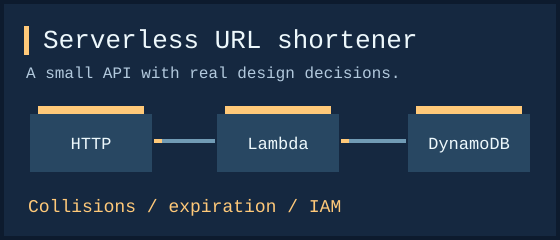
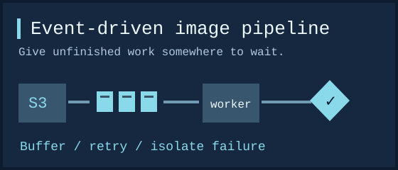
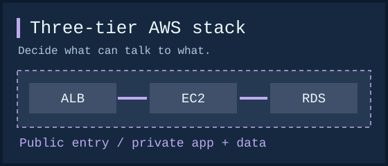
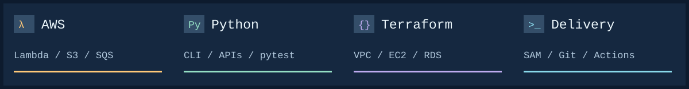
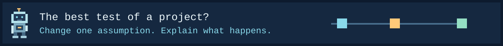
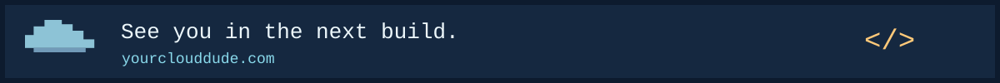

  

  <b>Practical cloud projects for developers who learn by building.</b> 
  AWS architecture, Python automation, and infrastructure as code.

  <a href="https://yourclouddude.com/">Website &amp; guides</a> &nbsp; / &nbsp;
  <a href="#on-the-workbench">Explore the projects</a> &nbsp; / &nbsp;
  <a href="https://x.com/yourclouddude">Find me on X</a>

## Welcome to my workshop

I'm **YourCloudDude**. I build and share projects that make cloud engineering easier to understand, from a small Python tool to an AWS system with queues, private networks, and infrastructure you can read.

Getting something to run is the starting point. I care about the questions that come next: **why this design, what can fail, and how do you find out?** My repositories explore those decisions through code, architecture notes, tests, and experiments you can try yourself.

## On the workbench

Pick a system you'd like to understand. Each project gives you a different design decision to investigate.

<table>
<tr>
<td width="50%" valign="top">

**[AWS Serverless URL Shortener](https://github.com/yourclouddude/aws-serverless-url-shortener)**

Build a small API, then follow the decisions behind collision-safe writes, expiring links, and separate read/write permissions.

`API Gateway` · `Lambda` · `DynamoDB` · `Python`

</td>
<td width="50%" valign="top">

**[AWS Event-Driven Image Pipeline](https://github.com/yourclouddude/aws-event-driven-image-pipeline)**

Follow an upload through S3, SQS, and Lambda. See how buffering, duplicate events, partial failures, and a dead-letter queue change the design.

`S3` · `SQS` · `Lambda` · `CloudWatch`

</td>
</tr>
<tr>
<td width="50%" valign="top">

**[Terraform AWS Three-Tier Web Stack](https://github.com/yourclouddude/terraform-aws-three-tier-web-stack)**

Trace a request from a public ALB to private EC2 and RDS. Explore security groups, network boundaries, and the choice to leave NAT out of the base stack.

`Terraform` · `VPC` · `EC2` · `RDS PostgreSQL`

</td>
<td width="50%" valign="top">

**[Python Safe File Organizer](https://github.com/yourclouddude/python-safe-file-organizer)**

Automate a messy folder with a read-only plan, collision-safe names, a move manifest, and rollback. Learn what an undo command can and cannot promise.

`Python` · `CLI` · `pytest` · `GitHub Actions`

</td>
</tr>
</table>

### Start small with Python

The **[Python Project Showcase](https://github.com/yourclouddude/python-project-showcase)** has four local builds: an expense tracker, a bookstore API, an invoice generator, and a portfolio generator. Start with sample input, inspect the output, then work through the practice exercises.

## Tools on my workbench

My focus is **serverless and event-driven AWS**, **Python tools and APIs**, and **infrastructure as code**. The projects make room for failure handling, IAM boundaries, testing, cleanup, and cost trade-offs alongside the working implementation.

## Open the experiment notebook

<b>Break an assumption. Follow the evidence.</b>

 

These are experiments to try, with the question each one should help you answer:

| Project | Try this | Explain what you observe |
| --- | --- | --- |
| URL shortener | Request a link whose expiration has passed, before TTL cleanup removes it. | Why must the redirect handler check expiration itself? |
| Image pipeline | Send a corrupt image alongside valid images. | How does partial batch failure keep good work from retrying? |
| Three-tier stack | Block the application's path to the database. | Why can the load balancer still see a healthy web process? |
| File organizer | Create a file with a name that already exists at the destination. | How does the plan protect the existing file? |

Use the repository instructions to run an experiment and clean up afterward. Write down your prediction first, then compare it with the result.

<b>Where should I start?</b>

 

- **New to Python projects?** Start with the [expense tracker](https://github.com/yourclouddude/python-project-showcase/tree/main/projects/06) and follow the sample data.
- **Want a first serverless system?** Try the [URL shortener](https://github.com/yourclouddude/aws-serverless-url-shortener) and trace one request.
- **Curious about async systems?** Open the [image pipeline](https://github.com/yourclouddude/aws-event-driven-image-pipeline) and ask why the queue is there.
- **Want to understand AWS networking?** Read the [three-tier stack](https://github.com/yourclouddude/terraform-aws-three-tier-web-stack) and follow the security group rules.

## Keep building with me

Find guides and more projects at **[yourclouddude.com](https://yourclouddude.com/)**, follow **[@yourclouddude on X](https://x.com/yourclouddude)**, or browse **[all my repositories](https://github.com/yourclouddude?tab=repositories)**.

